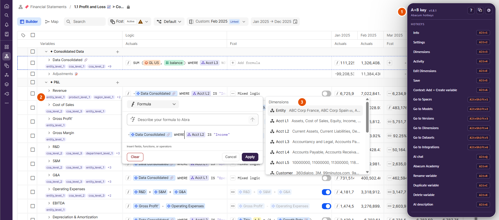
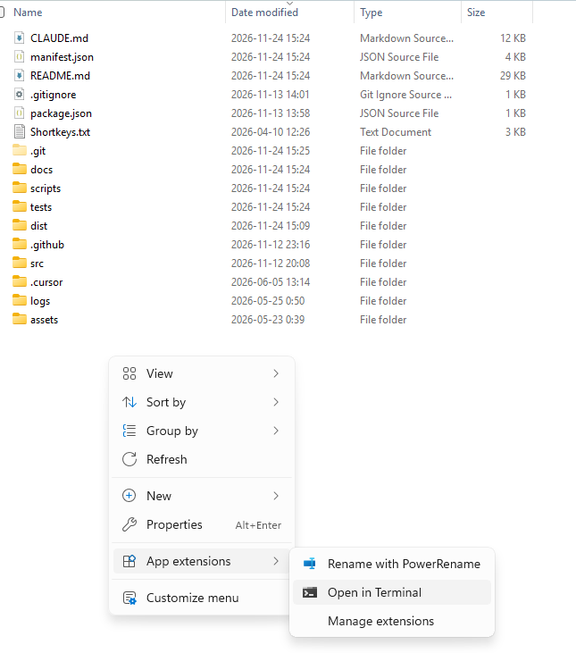

# AB-key Extension

Chrome (and Opera) Manifest V3 extension that adds hotkeys and small improvements to
[Abacum](https://app.abacum.io). It runs only on `*.abacum.io` pages. Not published in the Chrome
Web Store: install it unpacked (see [Install](#install-chrome)).

Click the extension icon on an Abacum page to open the **A+B key** panel with the hotkeys for that
page. The ⧉ button next to ⚙️ pops the panel out into its own small window that follows the
active Abacum tab; the ? button shows the guide tips of the page again. Every feature below can be
switched on or off in the extension options.



1. The **A+B key** panel with the hotkeys of the current page.
2. Dimensions toggle: the variable's dimensions shown as chips under its name.
3. Formula autocomplete opens beside the Cell Editor, so the formula stays visible.

## Hotkeys

Hotkeys are handled inside the Abacum page, so they are not listed in `chrome://extensions/shortcuts`.
They also work with a Russian keyboard layout.

| Hotkey | Where | What it does |
| --- | --- | --- |
| Alt+1–5 | any page with the right toolbar | Opens the right toolbar button by position, top to bottom (the AI agent button is skipped). Models: Info, Settings, Dimensions, Activity. Datasets: Info, Scheduler, Transform, Data usage, Activity. |
| Alt+Shift+1–9 | any page | Opens the left navigation link by position after Library: Spaces, Models, Versions, Dimensions, Datasets, Integrations. |
| Alt+S | any page | Save. |
| Alt+Q | any page | Opens / closes the AI chat. |
| Alt+H | any page | Opens Abacum Academy in a new tab. |
| Alt+E | models | Edit Dimensions (needs the right Dimensions panel open). |
| Alt+A | models | "+" → Create variable on the hovered row. |
| Alt+R | models | Renames the focused variable. |
| Alt+C | models | Duplicates the focused variable (or the ticked ones). Abacum saves the copy at once. |
| Alt+X | models | Deletes the focused variable (or the ticked ones). Applied on Save. |
| Alt+G | models | Regenerates the focused variable's description with Abacum's AI. Applied on Save. |

Hovering a toolbar button or a navigation link shows its hotkey in the tooltip.

## Features

**Guide**

- Tips at the buttons: the first time a page has AB-key hotkeys or features, a short tour points
  at each of them. "Only new features" limits it to features added after the version you started with.

**Appearance**

- Client name in the browser tab title.
- Light theme navigation (off by default).
- Darker values in model cells.

**Models**

- Formula autocomplete opens beside the Cell Editor instead of covering the formula (always on).
- Ctrl+Backspace in formulas deletes one word instead of clearing the whole formula.
- Dimensions toggle in the model builder: dimensions shown as chips under each variable name.
- Fix for Abacum's failing Save after deleting a new, never-saved variable.

**Datasets**

- Sum, count and average of the selected cells in the Viewer.
- Pin data columns in the Viewer.
- Two-row column headers in the Viewer.
- Clicking the f chip in a transformed column's header selects its transformation step.

Details for each feature are in [Releases](#releases).

## How it works

No build step: the files in `src/` are loaded as they are.

- `src/content/` — content scripts, only on `*.abacum.io`. Each reads its options from
  `chrome.storage.local` and applies changes without a page reload.
  - `content-script.js` — hotkeys (`keydown` on the page) and the click engine: configured
    selectors first, then a scored search by text and ARIA, with retries and a `MutationObserver`.
  - `toolbar-rail.js`, `sidebar-nav.js` — find the right toolbar buttons and left navigation links
    by position.
  - `ab-key-panel-host.js` — the in-page A+B key panel.
  - `ab-key-guide.js`, `ab-key-guide-steps.js` — the guide: tips at the buttons and their list.
  - `abacum-*.js` — the features above. Files ending in `-main.js` run in the page world
    (`"world": "MAIN"`) where they can reach Abacum's grid and editor objects.
- `src/background/` — service worker: install / update (config migrations), opening the panel
  on icon click and its pop-out window (`detached-window.js`).
- `src/shared/` — config schema with defaults and migrations, error codes, logger.
- `src/options/`, `src/popup/` — options page (feature toggles, hotkeys and actions, import /
  export, diagnostics logging) and the hotkey panel.

More in [`docs/ARCHITECTURE.md`](docs/ARCHITECTURE.md).

## Get the files

Put AB-key into a **permanent folder** first, e.g. `C:\Users\<you>\AB-key`. The browser keeps
AB-key's settings for that folder only: moving, renaming or deleting it later starts from default
settings. Do not leave it in Downloads.

- **With git:** `git clone https://github.com/AfricanBear/AB-key.git "$HOME\AB-key"`. Updates are a
  `git pull` (see [Update](#update)).
- **Without git:** on the [latest release](https://github.com/AfricanBear/AB-key/releases/latest)
  download **Source code (zip)** and unpack it into the permanent folder. The zip holds one folder
  (`AB-key-1.8.2\` and so on): the extension folder is the one with `manifest.json` in it, so move
  that folder's contents up or pick the inner folder in **Load unpacked**. Updates are one command
  (see [Update](#update)).

## Install (Chrome)

1. Open `chrome://extensions`.
2. Turn on **Developer mode** (toggle in the top-right corner). This is required: the **Load unpacked** button only appears in Developer mode.
3. Click **Load unpacked** and select the AB-key folder (the one that contains `manifest.json`).
4. Open an Abacum page and click the extension icon to see the hotkeys for that page.
5. To update, see [Update](#update): keep the same folder and click **Reload**.

## Install (Opera)

1. Open `opera://extensions`.
2. Turn on **Developer mode** — required for **Load unpacked**, same as in Chrome.
3. Click **Load unpacked** and select the AB-key folder (the one that contains `manifest.json`).
4. Open an Abacum page and try a hotkey, e.g. Alt+1.
5. To update, see [Update](#update).

If a hotkey does nothing:

- Refresh the Abacum tab (content scripts are not added to tabs opened before the install or update).
- Check that the feature or hotkey is enabled in the extension options.
- Save the options again: Save warns about hotkeys that cannot fire (missing or disabled action, no Alt/Ctrl/Meta, the same key twice).
- Turn on **Enable diagnostics logging** in the options, retry, and check the page console at the **Verbose** level (lines start with `[AB-key]`).

## Update

Update AB-key **in the folder it was loaded from** and click **Reload**: then the browser keeps all
its settings — hotkeys, feature toggles, pinned columns and the guide ("Only new features" and
which tips were already shown).

> Do not **Remove** AB-key and do not **Load unpacked** a new version from another folder. The ID
> of an unpacked extension comes from its folder path, so either way the browser sees a new
> extension with default settings, and the guide starts over.

Which way applies: run `git status` in the AB-key folder. If it says
`fatal: not a git repository`, AB-key was installed from a zip: use **From a zip**.

**From a git checkout:**

1. Open a terminal in the AB-key folder (see below) and run `git pull`.
2. `chrome://extensions` (or `opera://extensions`) → **Reload** on the AB-key card.
3. Refresh open Abacum tabs.

**Open a terminal in the AB-key folder** (Windows 11). It is the folder you picked in
**Load unpacked**, the one with `manifest.json`; `chrome://extensions` shows its path on the
AB-key card (with Developer mode on).

1. Open the folder in File Explorer.
2. Right-click an empty spot under the file list (not on a file).
3. Choose **Open in Terminal**. Depending on the Windows version it is in the menu itself or under
   **App extensions** (or **Show more options**).



The terminal opens with that folder as the current one; type the command (`git pull`, or the
`update.ps1` line below) and press Enter.

Other ways: in File Explorer click the address bar, type `powershell` and press Enter; or in any
terminal go to the folder first, e.g. `cd "$HOME\AB-key"` (use your own path).

**From a zip** (installed from a release's **Source code (zip)**):

1. Open a terminal in the AB-key folder (see above) and run:

   ```powershell
   powershell -ExecutionPolicy Bypass -File scripts\update.ps1
   ```

   The script downloads the latest release from GitHub, checks that it is AB-key, replaces
   `manifest.json`, `src\` and `assets\` in that folder (and `README.md` and itself), leaves
   everything else alone and prints the old and new version. If AB-key is already up to date it
   says so and changes nothing.
2. `chrome://extensions` → **Reload** on the AB-key card, then refresh open Abacum tabs.

Options of `update.ps1`:

- `-Version 1.8.2` installs that release instead of the latest one.
- `-Zip "<file>"` uses a zip you already have (e.g. no internet access to GitHub from PowerShell):
  a release's **Source code (zip)**, or `AB-key.zip` built by `scripts/package.ps1`.
- `-Target "<folder>"` updates another folder than the one the script is in.
- `-Force` reinstalls even if the folder already has that version.
- It refuses a git checkout: use `git pull` there.

**Older zip installs.** v1.8.0 and v1.8.1 have an `update.ps1` that needs `-Zip`; installs older
than v1.8.0 have none. Update them once with the script of the new release; after that the short
command above works. In PowerShell, one line at a time (put your AB-key folder in the last one,
the folder with `manifest.json`):

```powershell
Invoke-WebRequest "https://github.com/AfricanBear/AB-key/archive/refs/heads/main.zip" -OutFile "$HOME\Downloads\AB-key-main.zip"
```

```powershell
Expand-Archive -Force "$HOME\Downloads\AB-key-main.zip" "$HOME\Downloads\AB-key-main"
```

```powershell
powershell -ExecutionPolicy Bypass -File "$HOME\Downloads\AB-key-main\AB-key-main\scripts\update.ps1" -Target "<your AB-key folder>"
```

Then click **Reload**; the two downloaded items in Downloads can be deleted. (Unpacking a new zip
over the old folder by hand and clicking Reload works too.)

If you must reinstall anyway: Options → Advanced → Configuration → **Export** before, then
**Import** and **Save** after. That file has the hotkeys and toggles, including "Only new
features"; the list of tips already shown is not in it.

## Tests

Requires Node.js 22+. No dependencies to install.

- `npm test` — runs `tests/*.test.mjs` with the built-in `node --test` runner.
- Covered: config migrations (every schema version from v1), hotkey matching (layouts, hosts,
  model-only paths), locators for every default hotkey, tooltip hints, each feature in
  `src/content/abacum-*.js`, and the options page.
- Content scripts run in `node:vm` against a small fake DOM (`tests/helpers.mjs`); live Abacum
  behaviour still needs the manual checks in [`docs/TEST_PLAN.md`](docs/TEST_PLAN.md).
- `powershell -ExecutionPolicy Bypass -File scripts/validate.ps1` — manifest checks.

CI (`.github/workflows/ci.yml`) runs `scripts/validate.ps1`, `npm test` and `scripts/package.ps1` on every push to `main` and every pull request.

## Packaging

- `./scripts/package.ps1` — zip into `dist/`.
- `./scripts/package.ps1 -Target opera` — Opera-labeled zip.

## Releases

### v1.8.2

- **Update a zip install with one command.** `scripts\update.ps1` without `-Zip` downloads the latest GitHub release itself and does nothing when AB-key is already up to date; `-Version` picks a release, `-Force` reinstalls. `-Zip` still uses a file you have. Installs of v1.8.1 and older need one update with the new script first (README → Update → Older zip installs).
- README: **Get the files** (a permanent folder, git or the release zip, which folder to pick in Load unpacked), and how to tell a git install from a zip install (`fatal: not a git repository`).

### v1.8.1

- **Docs: how to open a terminal in the AB-key folder** for `git pull` (README → Update), with a screenshot. No code changes.

### v1.8.0

- **Guide: tips at the buttons** (Options → Guide, on by default). The first time an Abacum page has AB-key hotkeys or features, a short tour points at each of them with a tip: the left navigation (Alt+Shift+1–9), the right toolbar (Alt+1–5), AI chat, Academy, Save, the variable row hotkeys, the Dimensions toggle, Edit dimensions and Ctrl+Backspace in formulas on models; pinning, selection sum and the f chip on datasets. Tips show your own keys (a rebound key is shown as rebound; unbound hotkeys and switched-off features have no tip). A tip whose button is not on screen yet (another page, a closed panel, the formula editor) waits for a later visit. Back / Next, × skips the rest of the page, "Turn off tips" switches the guide off.
  - **Only new features** (off by default): tips only for features added after the AB-key version you started with (an update from v1.7.2 counts from v1.7.2); they carry a "New" badge.
  - **? in the A+B key panel** (next to ⧉ and ⚙️, only on Abacum pages) shows every tip of the current page again, also with the guide off; from the pop-out window it shows them in the Abacum tab.
  - **Update in place** ([Update](#update)): `scripts\update.ps1` (now inside the zip) updates a zip install in its own folder, so a Reload keeps every setting. Loading a new version from another folder starts from defaults.
  - Options → Guide → **Show all tips again** forgets which tips were shown. That list is stored apart from the config, so Export / Import does not carry it. No new permissions.

### v1.7.2

- **Alt+R opens the rename field faster.** It double-clicks the focused variable's name instead of going through the right-click menu, so there is no menu wait or flicker; the caret lands at the end of the name. Config migrates to schema v11: the shipped Alt+R action is replaced, one you edited is kept.
- Engine: steps can double-click an element (`trigger: "dblclick"`).

### v1.7.1

- **Dimensions toggle: "+N" shows the rest on hover.** A variable with more than three dimensions shows "+N" after the first three chips; hovering it now pops up the hidden dimensions at once, one per line, in the style of Abacum's tooltips (it used to be the browser's slow tooltip with the whole list). A shown chip cut off by a narrow column shows its full name on hover.

### v1.7.0

- **Pop out the hotkey panel.** A ⧉ button next to ⚙️ in the A+B key panel opens it in its own small browser window (no address bar or toolbar, like a password manager's pop-out) and closes the in-page panel. The window follows the active Abacum tab: switching tabs, windows or pages updates the list and the rail / navigation labels for Alt+1–5 and Alt+Shift+1–9; on other sites the last list stays. Hotkeys changed in Options show up at once (in the in-page panel too). A second ⧉ focuses the open window; it reopens where you left it. No new permissions.

### v1.6.1

- **Fix: Import kept the toggles, not the file's flags.** On Save the Options page wrote the toggles over the feature flags in the JSON, so flags from an imported file (or typed into the JSON) were silently replaced. The JSON is now what Save stores: a toggle edits its flag in the JSON, and importing or typing a flag moves its toggle.
- **Hotkey warnings on Save.** Options warns (and still saves) when a hotkey cannot fire: its action is missing or disabled, it has no Alt/Ctrl/Meta, or an earlier binding takes the same key on the same pages.
- The Configuration JSON moved to Options → Features → **Advanced** as a section that is collapsed by default; the page remembers whether you left it open. A failed Save (or a toggle blocked by broken JSON) opens it.
- Options explains the hotkey format (`alt+shift+1`, letters by physical key) and that diagnostics logs show at the console's **Verbose** level, prefixed `[AB-key]`.
- Removed the unused browser command (`run_primary_action`, never bound) with its disabled "Submit" example action, and the service worker's log in storage that nothing showed. Config migrates to schema v10: `commandBindings` and that action are dropped (the action stays if one of your hotkeys uses it); the old log is deleted on update.

### v1.6.0

- **Dimensions in the model builder** (Options → Features → Models, on by default). A third toggle next to "Show formulas" and "Show values", with the right panel's Dimensions icon. When on, every variable shows its dimensions as purple chips under its name (the first three, then "+N" with the full list on hover; "no dimensions" when it has none) and variable rows get taller; off restores Abacum's row height. One switch for all models, remembered in this browser.
  - The dimensions come from the builder grid's row data (page-world script, like the dataset columns); the extra row height goes through the grid's `getRowHeight` option, so Abacum's row density still applies.

### v1.5.0

- **Alt+G: AI description** (models). Regenerates the focused variable's description with Abacum's AI: opens the Info panel if needed, then Edit description → AI generate. Abacum replaces the description at once (including a hand-written one) and keeps the change until you press Save; reload without Save to get the old text back. Without a focused variable row nothing happens, so the model's own description is never touched. Config migrates to schema v9: Alt+G is added unless you already use it.

### v1.4.1

- **Fix: Save after deleting a new unnamed variable** (Options → Features, on by default). Abacum bug: create a variable, delete it before it was ever saved (right-click → Delete variable or Alt+X, e.g. you changed your mind before typing a name), then make any other change and click Save — every Save fails with "Variable marked for deletion does not exist or could not be found" until you reload the page and lose your edits. Abacum sends the deleted row's temporary key (like `0eqLj9i5oc-valid`) in the save request; AB-key drops such keys just before the request goes out. Real deletions (sent by variable code, `T_MD_…`) are untouched, and a save without such keys goes out unchanged. Abacum's own "variable without a name" toast on delete still shows; it is harmless.

### v1.4.0

- **Alt+X: delete variable** (models). Deletes the variable of the focused row (right-click → Delete variable); if rows are ticked, uses the bulk "Delete (n)" button instead. Abacum applies the deletion on Save (until then a reload brings the variable back) and refuses to delete a variable that other formulas use (it shows which ones). Config migrates to schema v8: Alt+X is added unless you already use it for your own action.

### v1.3.0

- **f chip selects the column's transformation** (Options → Features, on by default). In a dataset's **Viewer** tab with the **Transform** panel open, clicking the f chip in a transformed column's header now also selects the last transformation step that writes that column, as if you clicked the step itself. Abacum already shows the column in the panel header on that click, but the steps list kept its old selection. Clicks on cells (selection sum) and on the column name (sorting) are unchanged; with the panel closed nothing happens.
  - Abacum gives the f chip a pointer cursor but no hover state; now it darkens with a thin ring on hover, a bit more on press, and shows the tooltip "Show transformation step", like the pin button.

### v1.2.0

- **Ctrl+Backspace deletes one word in formulas** (Options → Features, on by default). Abacum binds Ctrl+Backspace (and Cmd+Backspace) in the formula editor to clearing the whole formula; now it deletes the word left of the cursor, like any text field. A variable chip is deleted as a whole, a selection is deleted as is. On Mac, Cmd+Backspace deletes to the start of the line. Ctrl+Delete (next word) already worked and is unchanged.
  - The CodeMirror instance is only visible in the page world, so a small `"world": "MAIN"` script handles the key; the isolated script mirrors the option into an attribute on `<html>`.

### v1.1.2

- **Version number** next to the title in the A+B key panel and on the Options page (read from `manifest.json`), so it is easy to see which build is installed.

### v1.1.1

- **Two-row column headers in dataset Viewer** (Options → Features, on by default). The header is twice as tall: the type icon, the full column name and the sort arrow on top; the pin, filter and options buttons below, always visible (Abacum shows filter and options only on hover). Off: one row as before.
  - The header height is an AG Grid option, so the page-world script sets it to twice Abacum's value and restores it when the feature is turned off.
- **Fix: the pin no longer overlaps the options button.** It was placed at a fixed 50 px from the right edge; it is now measured from Abacum's own header buttons. In one-row mode the column name leaves room for the pin.

### v1.1.0

- **Pin columns in dataset Viewer** (Options → Features, on by default). Abacum pins only the row-type/checkbox column; data columns cannot be pinned from its UI. Hover a column header in a dataset's **Viewer** tab and click the pin: the column moves next to the checkbox column and stays visible while scrolling right. You can still resize it; click the pin again to unpin.
  - Remembered per dataset in this browser (`chrome.storage.local`), together with the width of every column you resize by mouse. Both are restored when the Viewer opens again (page load, Loads → Viewer, F5). Nothing is sent to Abacum, and other users see Abacum's default layout.
  - Pinned columns keep the grid's order (AB-key never moves columns: Abacum may save the column order). Pinning is refused with a short note when pinned columns would take more than 60% of the grid.
  - Options → Features → **Reset pinned columns and widths** forgets them for all datasets.
  - Technical: a small page-world script (`"world": "MAIN"`, Chrome 111+ / Opera 97+) reaches the AG Grid api through React and calls `applyColumnState`; it has no `chrome.*` access and talks to the content script with DOM events.

### v1.0.0

- **Darker values also for read-only rows.** Variables linked from another model (the arrow icon) and the dimension rows shown on expand were still very pale: Abacum marks their cells `disabled-value-cell` and draws the value at opacity 0.4 in grey. With "Darker values in model cells" on, they now use the grid's text colour at opacity 0.85 — easy to read, still a touch lighter than editable values.

### v0.10.1

- **Fix light theme nav** (Options → Features). An Abacum release renamed the hashed classes it relied on, so the icons stayed white on the light column. It now uses only stable hooks: `data-testid="sidebar"`, the `sidebar-section-button-*` buttons and the logo ``. Icons are dark, hover is a light tint, the current section is lavender.
  - Abacum marks the current section only with a hashed class, so AB-key marks it itself from the URL (`/app/modules/…` → Models) and updates it on in-app navigation and Back. Search and More are never highlighted.
  - The right drawer (AI chat, side panels) is no longer restyled by mistake.
  - Still no work at all while the feature is off.

### v0.10.0

New hotkeys (config schema v7; a key you already use for your own action is not taken over):

- **Alt+Shift+1–9: left navigation.** The N-th section link after Library — today Spaces, Models, Versions, Dimensions, Datasets, Integrations. "More" (a menu) and the bottom items are skipped. Positions are read from the page on every keypress, so new sections or links that move out of "More" get a number without an update. The A+B key panel shows them as "Go to …", and hovering a link adds the key to its tooltip ("Models · Alt+Shift+2").
- **Alt+Q: AI chat** on/off (the button at the bottom of the right rail). Works from inside the chat input too.
- **Alt+H: Abacum Academy** — opens Help & support → Abacum Academy, which Abacum opens in a new tab.
- **Alt+R: rename variable** (models). Opens the name field of the variable whose row has the focused cell — same as right-click → Rename variable. Esc cancels.
- **Alt+C: duplicate variable** (models). Duplicates the variable of the focused row (right-click → Duplicate variable); if rows are ticked, uses the bulk "Duplicate (n)" button instead. Abacum saves the copy immediately.
- Engine: positional `sidebarNav` locator, `preferredOnly` profiles (no page-wide text fallback), steps that open a right-click menu (`trigger: "contextmenu"`), and `executionPolicy.alternatives`.
- Esc for Edit Dimensions is not needed any more: Abacum closes the dialog with Esc itself (note: it discards unapplied changes without asking).

### v0.9.0

- **Formula hints beside the Cell Editor** (Models, always on). Abacum's formula autocomplete (Operators, Variables, …) used to open at the caret, often above it, covering the formula. It now opens to the right of the Cell Editor, top-aligned; to the left when the right side has no room; unchanged when neither side fits. Typing, arrow keys and clicking a hint work as before.
  - Abacum re-creates the hint list on every keystroke, so the script watches `<body>` children (no subtree) — only while a formula editor has focus. No work at all otherwise.
### v0.8.1

- **Lighter on resources.** Content scripts and host permissions are limited to `*.abacum.io` (were `<all_urls>`); the A+B key panel still opens on other sites when you click the icon.
- **Light theme nav** no longer watches every class change on the page; it observes only `<head>`, and only while the feature is on.
- **Client name in tab title** no longer runs a 1-second timer and a whole-page observer; it watches only `<title>` and retries briefly until the client logo has loaded.
- `npm test` has a 30 s per-test timeout, so a hanging test cannot block CI.

### v0.8.0

- **Selection sum in datasets** (Options → Features, on by default). In a dataset's **Viewer** tab, select two or more cells to see a tooltip with the number of numeric values, **Sum** and **Avg**, at the bottom-right of the selection.
  - Uses AG Grid's `ag-cell-range-selected*` classes; only on `/app/datasets…` (Models already have Abacum's own tooltip).
  - Numbers are parsed strictly (`13065.0`, `-1,234.5`); dates, text and empty cells are skipped.
  - AG Grid renders only rows near the viewport: if the selection may continue beyond them, the tooltip says "Visible rows only".

### v0.7.0

- **Darker values in model cells** (Options → Features, on by default). Abacum shows model values in grey (`rgb(82,82,82)`); the extension gives them the grid's own near-black text colour (`rgb(23,23,23)`). Anchored on `data-testid="value-cell"`, not on hashed classes; values or icons with their own colour keep it. Toggling applies to open tabs without reload.

### v0.6.5

- **Alt+E and Alt+A only on model pages** (`https://app.abacum.io/app/modules*`). Elsewhere they do nothing and are hidden from the A+B key panel. Alt+S and Alt+1–5 stay available on all Abacum pages.
- New optional hotkey field `paths`: list of pathname prefixes where the hotkey is active. Config migrates to version 6 (adds `paths` to Alt+E / Alt+A unless you already set your own).

### v0.6.4

- **Hotkeys in rail tooltips:** hovering a right toolbar rail button shows its hotkey next to Abacum's tooltip, e.g. "Info · Alt+1". The hotkey is read from the current config, so rebinding is reflected; buttons without a hotkey (and the AI agent button) are left as is.

### v0.6.3

- **Alt+C (Create section) removed.** Its selector targeted buttons while Abacum renders "Create section" as a menu item, so it only worked by a text fallback in an already open menu. Config migrates to version 5: the action and any hotkey bound to it are dropped; a user's own action on Alt+C is kept.

### v0.6.2

- **Alt+S:** Save inside an open dialog first, then the model builder Save button (`testid-builder-save-button`); the previous generic search remains the fallback, so Alt+S still works on other pages.
- **Alt+A:** "+" button by `testid-builder-add-button-anywhere`, then exactly **Create variable** in its menu (`testid-builder-add-dropdown-anywhere`). Before, "contains Create" also matched Create group / Create section and worked only because Create variable was first.
- New locator option `preferredSelectors`: tried in order; the first visible, enabled, uncovered element matching `textCriteria` wins, before the scored search.
- Config migrates to version 4 (only shipped defaults are replaced; edited locators are kept).

### v0.6.1

- **Fix Alt+E (Edit Dimensions):** it clicked "Show Builder Formulas" instead. The locator had a role-only fallback (`{ role: "button" }` without a label) that matched every button and outscored the real one. Role-only criteria no longer add candidates; Alt+E now uses only `[data-testid='testid-builder-bulk-dimensions']`. If the button is absent, disabled or covered by a modal, nothing is clicked.
- Config migrates to version 3 (only the shipped Alt+E selector is updated; custom selectors are kept).

### v0.6.0

- **Alt+1–5 rewritten:** click the right toolbar rail button by **position** (top to bottom) on every Abacum object type — Models, Dimensions, Datasets, Versions. Lookup uses Abacum's `data-testid="toolbar-rail-button-*"` (the old `side-action-bar` container no longer exists); the AI agent button is excluded; a geometric fallback is used if the test ids change. No page-wide fallback, so a missing button means no click.
- The A+B key panel shows the actual rail labels of the current page for Alt+1–5.
- **Fix:** content script failed to load (ES `import` in a content script) — all hotkeys were dead in the unreleased build.
- **Fix:** config was reset to defaults on every extension update/reload; now only on first install.
- **Fix:** hotkeys work with any keyboard layout (matched by physical key, e.g. Russian layout); `preventDefault` is now synchronous; config is cached instead of read on every keypress.
- **Fix:** retries no longer burn out within milliseconds on busy pages; `timeoutMs` is honoured.
- **Fix:** packaged zip now includes `assets/` (icons).
- Ctrl+Shift+Y/U browser commands are unbound by default; the generic "Submit on any site" action is disabled.
- "Experimental features" toggle removed; config migrates automatically to version 2.

### v0.5.0

- Alt+1–5 click the Abacum toolbar by index; Alt+1–4 fall back to aria labels.
- Alt+5 added for the fifth rail button.

### v0.4.1

- Options layout: Save in header; Reload, Export, Import in Configuration toolbar.

### v0.4.0

- **Light theme nav** for `*.abacum.io`: optional drawer and nav styling from options.
- Preview images in options show default vs light nav icon appearance.

### v0.3.1

- Popup hotkey labels updated: Edit Dimensions, Context: Add + Create variable.

### v0.3.0

- Options page redesigned with dark glassmorphism styling and extension logo in the header.

### v0.2.2

- Toolbar popup from the extension icon shows Abacum hotkeys (short label + key binding).
- Dark glass-style popup panel.

### v0.2.1

- Abacum tab title can be turned on or off in the **A+B key** options page (`abacumTabTitleEnabled`).
- Options window title renamed from “MV3 Click Automation” to **A+B key**.
- Tab title script reacts to saved settings; refresh open Abacum tabs if a change does not apply immediately.

### v0.2.0

- On `app.abacum.io`, the browser tab title is prefixed with the client name from the first non-empty `img[alt]`.
- DOM mutation observer and periodic refresh keep the prefix when React updates the page title.

Full release notes (including v0.1.0 Opera packaging): [`docs/RELEASE_NOTES_OPERA.md`](docs/RELEASE_NOTES_OPERA.md).

## Project Status

For implementation history and continuation notes, see:

- [`docs/PROJECT_STATUS.md`](docs/PROJECT_STATUS.md)
- `docs/ROADMAP.md` — planned features
